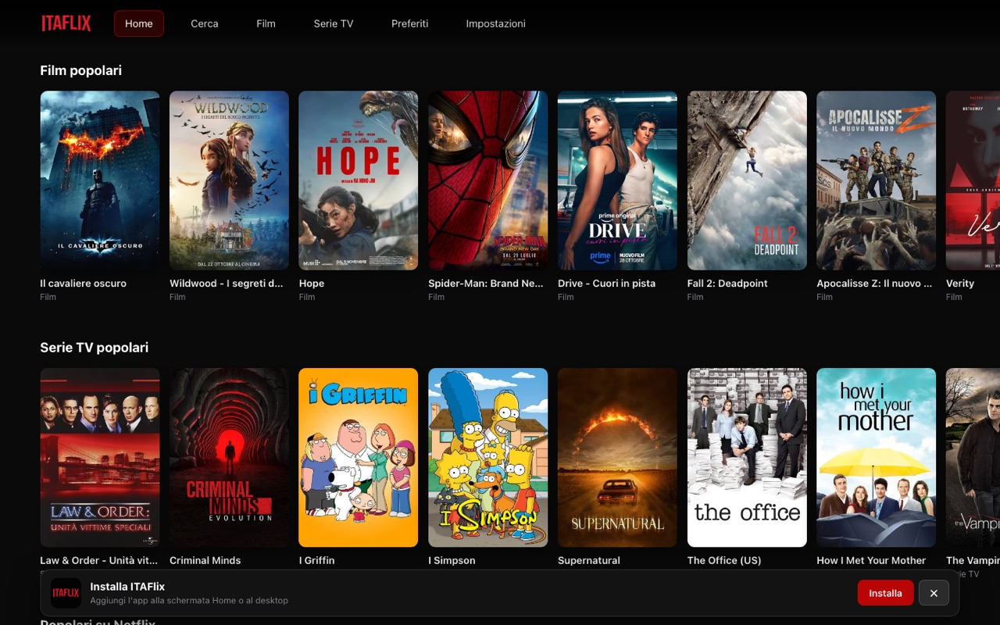
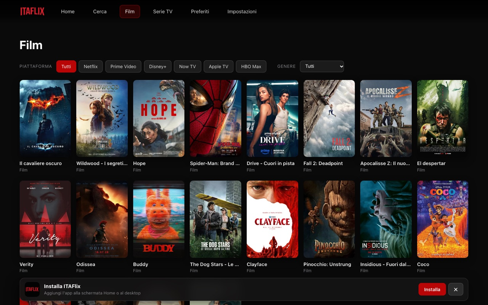
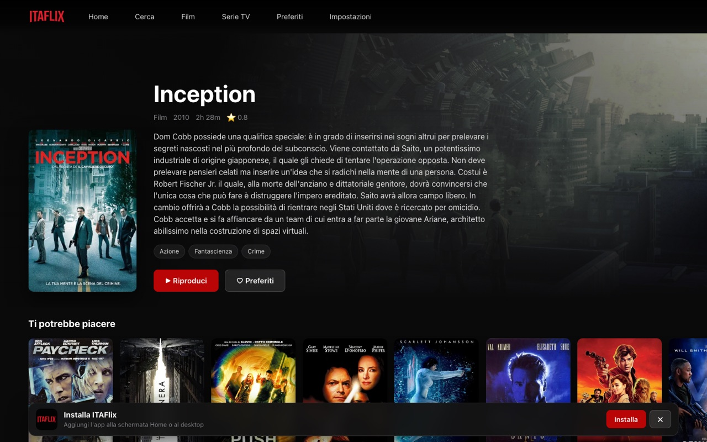

# 🎬 ITAFlix

Web app in stile tvOS per esplorare film e serie TV: home con shelf tematiche,
ricerca, catalogo con filtri, dettaglio con cast e raccomandati, episodi,
preferiti sincronizzati con TMDb e player HLS con ripresa della posizione.

## Screenshot

| Catalogo con filtri | Dettaglio film |
|---|---|
|  |  |

## Funzionalità

- Home con 8 shelf TMDb (film, serie, anime, Netflix, Prime, Disney+, Now, Apple, HBO)
- Ricerca con debounce su film e serie
- Cataloghi Film/Serie con filtri per **piattaforma** e **genere** e "carica altri"
- Dettaglio film con collezione e raccomandati; dettaglio serie con stagioni,
  elenco episodi e "prossimo episodio"
- Player HLS con scelta qualità, ripresa della posizione e salvataggio ogni 5 secondi
- **Preferiti** locali in `localStorage` e, dopo il login TMDb, sincronizzati
  sull'account
- Layout **responsive** (desktop, tablet, smartphone) e installabile come PWA
- Scorciatoie player: `spazio` play/pausa · `←`/`→` ±10s · `M` muto · `F` schermo intero · `Esc` chiudi

## Come è fatto

La web app vive interamente in `app/` ed è un port dell'app tvOS `itaflix-tvos`:
stessa logica dati (TMDb) e stesso servizio **VixSrc**, con UI React in stile TVML
(logo originale, voci di menu che si accendono di rosso quando sono a fuoco).

| Percorso | Cosa è |
|---|---|
| `app/src/lib/` | modelli, client TMDb, i18n, impostazioni, storage, preferiti |
| `app/src/components/` | NavBar, Row, Tile, TmdbLogin, InstallPrompt |
| `app/src/pages/` | Home, Search, Catalog, Movie, TvShow, Season, My, Settings |
| branch `Old` | la vecchia pagina statica ITAFlix (HTML + iframe VixSrc) |

La riproduzione apre il **player ufficiale di VixSrc** in una pagina dedicata:
non serve alcun backend. L'apertura avviene **senza header `Referer`**, perché
VixSrc blocca con `403` i referer dei domini di hosting gratuito (`*.vercel.app`,
`*.netlify.app`, `*.github.io`, …): un iframe da Vercel non funzionerebbe, una
navigazione top-level senza Referer sì.

## Tecnologie

- **React 18 + Vite**, sito statico (nessun backend)
- [TMDb API](https://www.themoviedb.org/documentation/api) per informazioni su film e serie
- [VixSrc.to](https://vixsrc.to) per lo streaming (player in pagina dedicata)

Dettagli di sviluppo e architettura in [`app/README.md`](app/README.md).

## ⚠️ Disclaimer

> Questo progetto è solo a scopo dimostrativo ed educativo. **Non ospita alcun
> contenuto**, ma rimanda ai link di servizi di terze parti. L'utilizzo di
> servizi di terze parti per la visione di contenuti protetti da copyright può
> violare le leggi sul diritto d'autore.
